<!-- banner + cards are generated by scripts/build.mjs -->

  

  

  
  

## Hi, I'm Chokun

I study industrial engineering at Chulalongkorn University and I'm doing my co-op at Analog Devices Thailand, on the wafer sort floor.

At work I look for waste in how material moves around the floor, and I build the reports that track it: OEE, headcount, and the data behind a DMAIC project.

Outside work I make things for fun. Browser games, a racing game with a manual gearbox, 3D explainer videos, and a Thai animated series that is rendered entirely from code.

## Engineering and tools

  
  
  <a href="https://chokylion.github.io/Wafer-Probe-Random/"></a>
  <a href="https://github.com/Chokylion/router-skill"></a>
  <a href="https://chokylion.github.io/stadium-seatview/"></a>
  <a href="https://github.com/Chokylion/badminton-app"></a>

## Games

  <a href="https://chokylion.github.io/claude-racer/"></a>
  <a href="https://chokylion.github.io/golf-game/"></a>
  <a href="https://chokylion.github.io/ensense/"></a>
  
  <a href="https://chokylion.github.io/Lucky-Draw-Games/"></a>
  <a href="https://github.com/Chokylion/popcat-event"></a>

## 3D and animation

  <a href="https://chokylion.github.io/imi-workstation-video/"></a>
  

## What I use

  
   
  
    
  
  
  
  

## Activity

<!-- refreshed daily by .github/workflows/stats.yml -->

  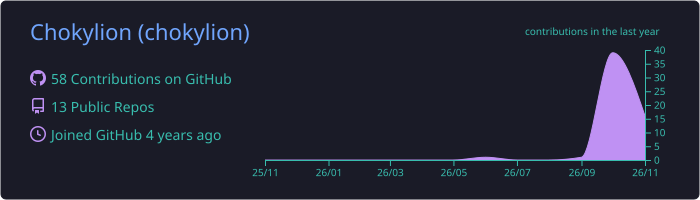
  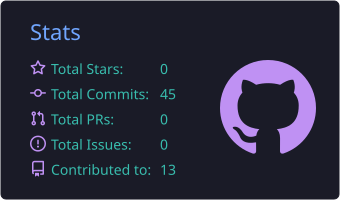
  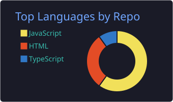

  

